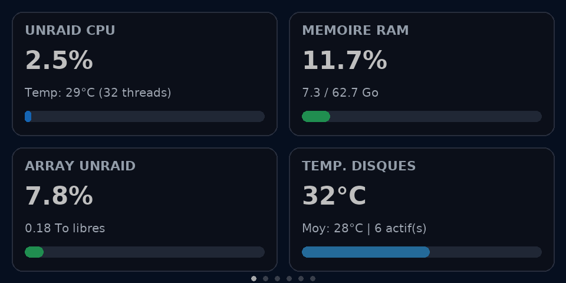
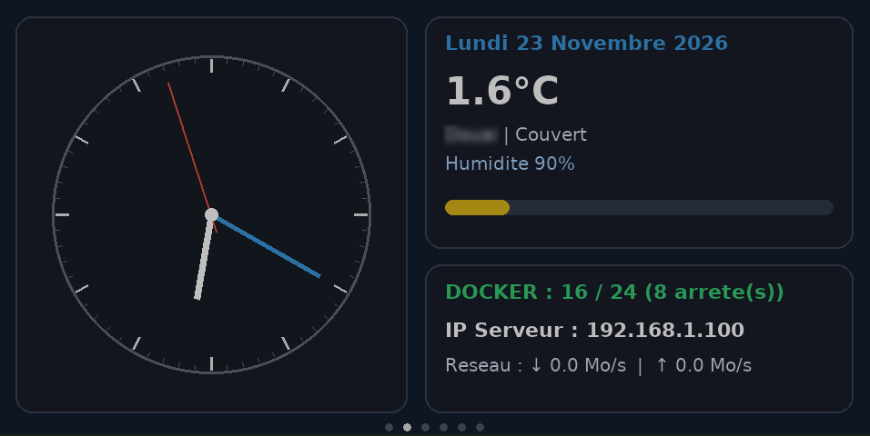
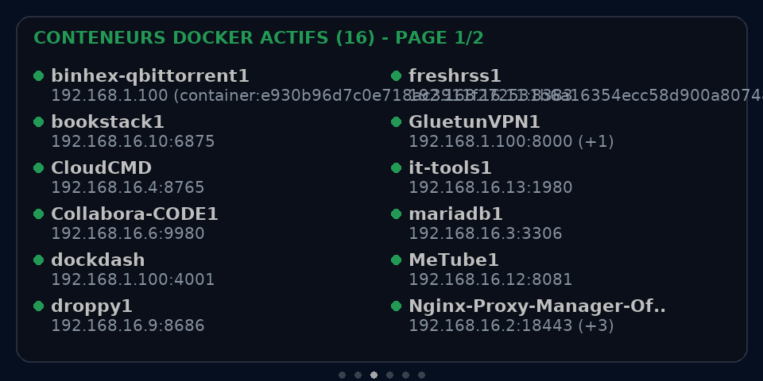
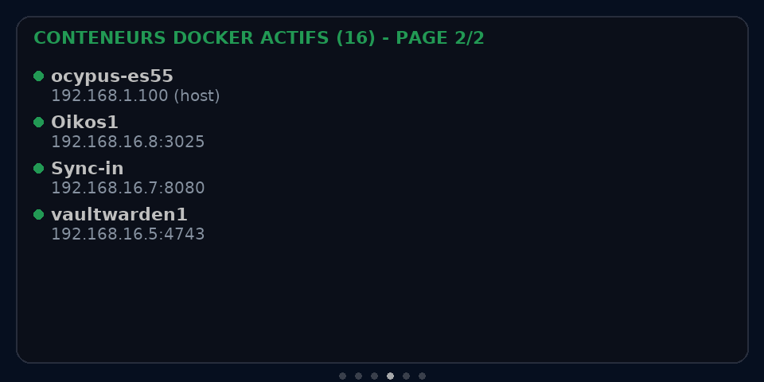
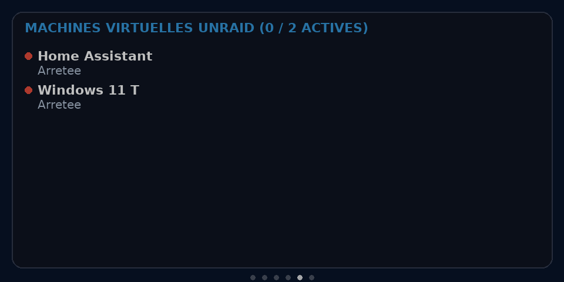
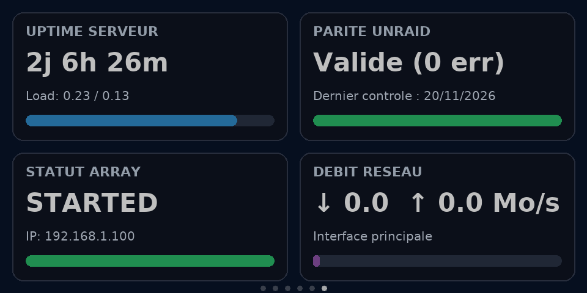

> 🇫🇷 [Lire en Français](README.md) | 🇬🇧 **English**

# 🖥️ Unraid & Docker Driver for Ocypus Sigma ES55 (960×480)

Standalone native Linux & Docker driver to run the **Ocypus Sigma ES55** USB display (`33c3:7789` via `/dev/ttyACM0`) directly from an **Unraid** server (or standard Linux), without requiring a Windows VM or proprietary software.

---

## 📸 6-Page Dashboard Preview

| Page 1 — Hardware & Storage | Page 2 — Clock, Date & Weather |
| :---: | :---: |
|  |  |

| Page 3 — Active Docker Containers (1–12) | Page 4 — Active Docker Containers (13–24) |
| :---: | :---: |
|  |  |

| Page 5 — Unraid Virtual Machines | Page 6 — System Uptime & Parity |
| :---: | :---: |
|  |  |

---

## ✨ Key Features

* **Modular 6-Page Dashboard (`PAGE_ORDER`):**
  1. **Page 1 — Hardware & Storage:** CPU load & temperature, RAM usage, Array free space, and hard drive temperatures (read directly from `/var/local/emhttp/disks.ini` *without spinning up sleeping drives*), featuring **dynamic color alerts** (orange/red on high thresholds).
  2. **Page 2 — Clock, Date & Weather:** Large analog hand clock or XXL digital clock (`CLOCK_MODE`), date formatted in French or English (`DATE_LANG`), live weather via Open-Meteo (temperature, feels-like, wind speed, humidity, daily min/max), Docker counter, and server IP.
  3. **Page 3 — Active Docker Containers (1–12):** Live list of running containers with their local IP address and exposed ports.
  4. **Page 4 — Active Docker Containers (13–24):** Continuation of running containers.
  5. **Page 5 — Unraid Virtual Machines:** Live status (running/stopped) of all KVM/QEMU VMs.
  6. **Page 6 — System & Parity:** Server uptime, load average, Array status, and last parity check status.
* **Dynamic Wallpapers & Animated GIFs:** Sequential or random slideshow (`WALLPAPER_SHUFFLE`), dedicated per-page background mode (`CUSTOM_PAGE_BG` using `page1.jpg` to `page6.jpg`), and **native support for animated `.gif` files**.
* **Automatic Solar Night Mode (`NIGHT_MODE`):** Automatically lowers screen brightness between the exact sunset and sunrise times calculated for your city.
* **Multi-Screen Support (`DEVICE_PROFILE`):** Configurable JSON profiles in `devices/` to easily adapt resolution (`960×480`, `800×480`, `480×480`, `480×320`, `1280×480`) or serial framing.
* **Built-in HTTP Remote API:** Control the display remotely from a web browser, smartphone shortcut, Stream Deck, or Home Assistant.

---

## 🚀 Step-by-Step Installation

### Method 1: Unraid (XML Template — Recommended)
1. Open the Unraid Web Terminal (`>_` in the top right) and create the build directory:
   ```bash
   mkdir -p /mnt/user/appdata/ocypus-es55-build
   cd /mnt/user/appdata/ocypus-es55-build
   ```
2. Copy all files from this repository (`Dockerfile`, `es55_driver.py`, `unraid-template.xml`, plus the `devices/` and `wallpapers/` folders) into `/mnt/user/appdata/ocypus-es55-build/`.
3. Verify that the USB display is detected:
   ```bash
   ls -la /dev/ttyACM*
   ```
4. Build the local Docker image:
   ```bash
   docker build -t ocypus-es55-config:latest .
   ```
5. Copy the XML template to your Unraid USB flash drive:
   ```bash
   cp /mnt/user/appdata/ocypus-es55-build/unraid-template.xml /boot/config/plugins/dockerMan/templates-user/my-ocypus-es55.xml
   ```
6. In the Unraid WebUI, go to **Docker** > **Add Container**, select **`my-ocypus-es55`** from the **Select a template** dropdown at the top, enter your city in **`WEATHER_CITY`**, and click **Apply**.

### Method 2: Docker Compose (Unraid Compose Plugin or Standard Linux)
```bash
docker compose up -d --build
```
> **Note:** If a user on a standard Linux distribution such as Ubuntu or Debian does not have the Unraid directories `/var/local/emhttp` or `/etc/libvirt/qemu`, they simply need to comment out those 3 lines under `volumes:` with a `#`; the Python script safely ignores missing directories.

---

## ⚙️ Environment Variables

| Variable | Default | Description |
| :--- | :--- | :--- |
| `DEVICE_PROFILE` | `ocypus_es55` | JSON profile name inside `/config/devices` (`ocypus_es55`, `screen_800x480`, `ocypus_es45_480x480`, etc.) |
| `SERIAL_PORT` | `/dev/ttyACM0` | USB serial device path |
| `SCREEN_BRIGHTNESS` | `80` | Daytime brightness (`0` to `100`) |
| `NIGHT_MODE` | `true` | Enable automatic sunset-to-sunrise dimming (`true`/`false`) |
| `NIGHT_BRIGHTNESS` | `15` | Nighttime brightness (`0` to `100`) |
| `PAGE_ORDER` | `1,2,3,4,5,6` | Order and selection of displayed pages |
| `PAGE_SWITCH_INTERVAL` | `30` | Seconds per page |
| `CLOCK_MODE` | `analog` | Page 2 clock style (`analog` or `digital`) |
| `DATE_LANG` | `en` | Page 2 date language (`fr` or `en`) |
| `WEATHER_CITY` | `Paris` | City used for weather and sunrise/sunset times |
| `WEATHER_URL` | *(empty)* | Custom Open-Meteo API URL (optional) |
| `CUSTOM_PAGE_BG` | `false` | Enable per-page wallpaper (`page1.jpg` to `page6.jpg`) |
| `WALLPAPER_SHUFFLE` | `false` | Randomize wallpaper slideshow (`true`/`false`) |
| `SLIDESHOW_INTERVAL` | `600` | Seconds between wallpaper changes |
| `BG_DIM` | `35` | Wallpaper dimming percentage (`0` to `90`) for text readability |
| `SCREEN_ROTATION` | `0` | Display rotation (`0`, `90`, `180`, `270`) |
| `API_PORT` | `8799` | Local HTTP remote API port |
| `TZ` | `Europe/Paris` | Timezone |

---

## 🎮 Local HTTP Remote API

Accessible directly via the Unraid container **WebUI** button or HTTP GET requests:

* `http://<UNRAID_IP>:8799/status` : Returns live JSON status (`page`, `paused`, `night`)
* `http://<UNRAID_IP>:8799/next` : Switch to the next page immediately
* `http://<UNRAID_IP>:8799/prev` : Switch to the previous page
* `http://<UNRAID_IP>:8799/page/1` *(to `6`)* : Jump directly to a specific page
* `http://<UNRAID_IP>:8799/pause` : Pause or resume automatic page rotation
* `http://<UNRAID_IP>:8799/night/toggle` : Manually toggle night/day mode

---

## 🙏 Acknowledgments
* Built in collaboration with **Gemini** (Google AI) for USB serial protocol reverse-engineering and Python/Docker driver development.

## 📄 License
Distributed under the **MIT License** — see [LICENSE](LICENSE) for details.
