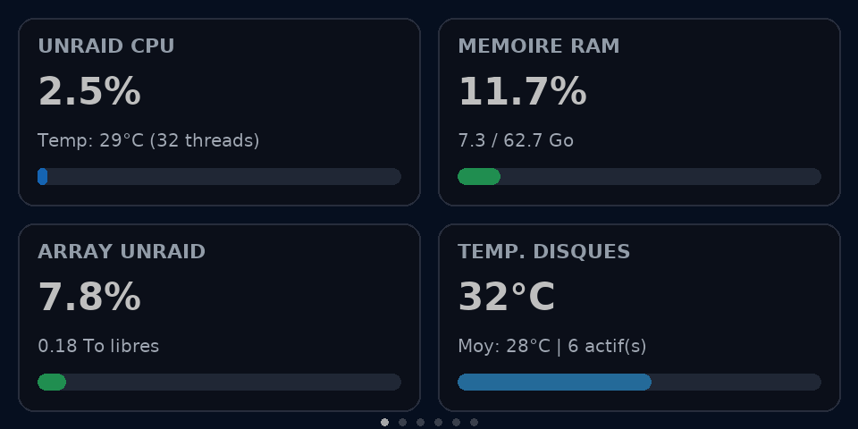
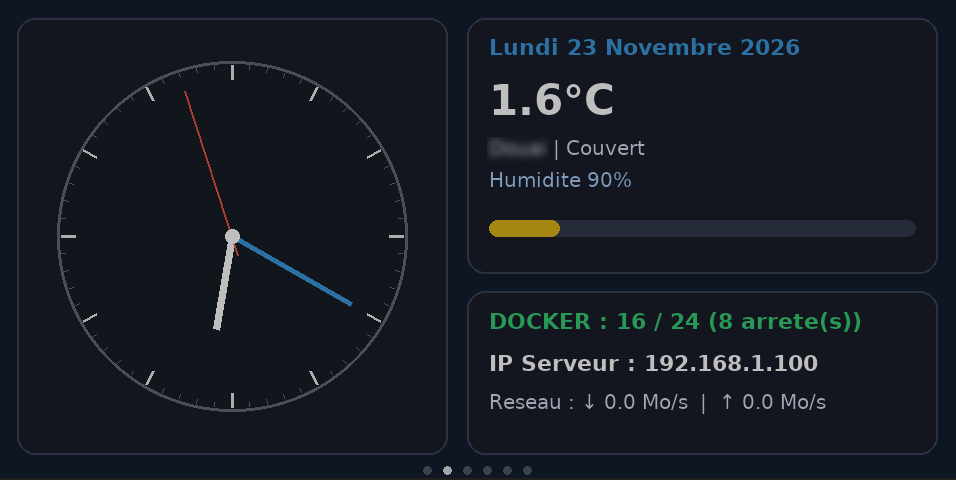
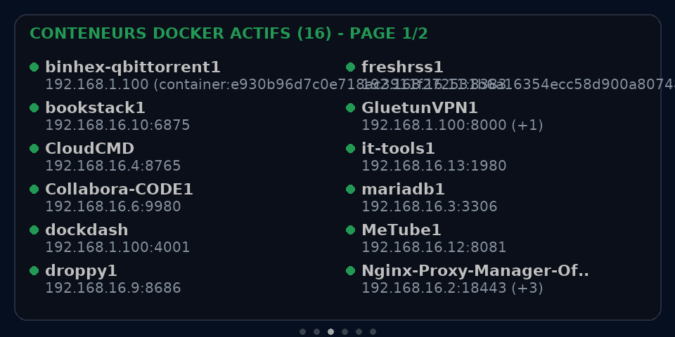
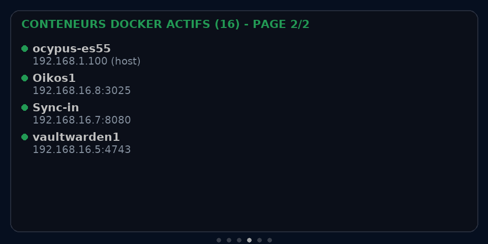
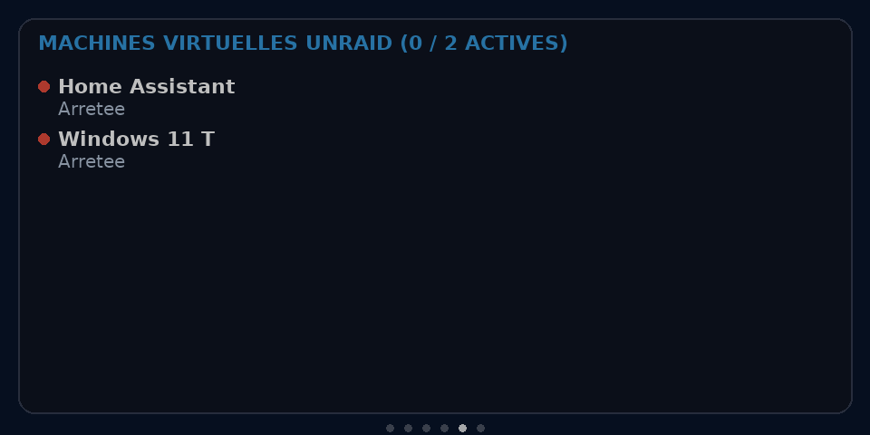
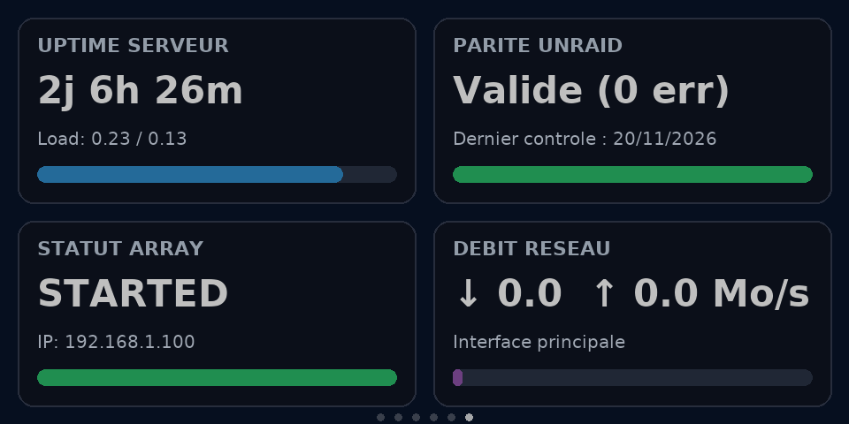

> 🇫🇷 **Français** | 🇬🇧 [Read in English](README.en.md)

# 🖥️ Pilote Unraid & Docker pour Ocypus Sigma ES55 (960×480)

Pilote Linux natif et autonome sous Docker pour piloter l'écran USB **Ocypus Sigma ES55** (`33c3:7789` via `/dev/ttyACM0`) directement depuis un serveur **Unraid**, sans aucune machine virtuelle Windows ni logiciel propriétaire.

---

## 📸 Aperçu des 6 pages

| Page 1 — Matériel & Stockage | Page 2 — Horloge, Date & Météo |
| :---: | :---: |
|  |  |

| Page 3 — Conteneurs Docker (1–12) | Page 4 — Conteneurs Docker (13–24) |
| :---: | :---: |
|  |  |

| Page 5 — Machines Virtuelles Unraid | Page 6 — Système & Parité |
| :---: | :---: |
|  |  |

---

## ✨ Fonctionnalités principales

* **Tableau de bord modulaire sur 6 pages (`PAGE_ORDER`) :**
  1. **Page 1 — Matériel & Stockage :** Charge et température CPU, mémoire RAM, espace libre de l'Array et températures des disques durs (lues directement dans `/var/local/emhttp/disks.ini` *sans sortir les disques de veille*), avec **alertes couleurs dynamiques** (orange/rouge en cas de seuil élevé).
  2. **Page 2 — Horloge, Date & Météo :** Grande horloge analogique à aiguilles ou numérique XXL (`CLOCK_MODE`), date formatée en français ou anglais (`DATE_LANG`), météo en temps réel via Open-Meteo (température, ressenti, vent, humidité, min/max du jour), compteur Docker et IP serveur.
  3. **Page 3 — Conteneurs Docker (1 à 12) :** Liste des conteneurs actifs avec leur adresse IP locale et leurs ports exposés.
  4. **Page 4 — Conteneurs Docker (13 à 24) :** Suite de la liste des conteneurs actifs.
  5. **Page 5 — Machines Virtuelles Unraid :** Statut en direct (actif/arrêté) de toutes vos VMs KVM/QEMU.
  6. **Page 6 — Système & Parité :** Uptime du serveur, Load Average, statut de l'Array et dernière vérification de parité.
* **Fonds d'écran dynamiques & GIF animés :** Diaporama séquentiel ou aléatoire (`WALLPAPER_SHUFFLE`), mode fond d'écran dédié par page (`CUSTOM_PAGE_BG` avec `page1.jpg` à `page6.jpg`) et **support natif des `.gif` animés**.
* **Mode nuit solaire automatique (`NIGHT_MODE`) :** Réduit automatiquement la luminosité entre l'heure exacte du coucher et du lever du soleil calculée pour votre ville.
* **Support multi-écrans (`DEVICE_PROFILE`) :** Profils JSON configurables dans `devices/` pour adapter facilement la résolution (`960×480`, `800×480`, `480×480`, `480×320`, `1280×480`) ou le protocole série.
* **API télécommande HTTP intégrée :** Pilotage à distance depuis un navigateur, un smartphone, un Stream Deck ou Home Assistant.

---

## 🚀 Installation pas-à-pas sur Unraid

### Étape 1 : Télécharger les fichiers sur votre serveur
Ouvrez le terminal web d'Unraid (`>_` en haut à droite) et créez le dossier d'installation :

```bash
mkdir -p /mnt/user/appdata/ocypus-es55-build
cd /mnt/user/appdata/ocypus-es55-build
```
Copiez tous les fichiers de ce dépôt (`Dockerfile`, `es55_driver.py`, `unraid-template.xml`, ainsi que les dossiers `devices/` et `wallpapers/`) dans `/mnt/user/appdata/ocypus-es55-build/`.

### Étape 2 : Vérifier le port série USB de l'écran
Branchez l'écran Ocypus Sigma ES55 sur un port USB interne ou arrière de votre serveur Unraid, puis vérifiez qu'il est bien détecté :

```bash
ls -la /dev/ttyACM*
```
*(Il apparaît généralement sous **`/dev/ttyACM0`**).*

### Étape 3 : Compiler l'image Docker locale
Dans le terminal Unraid, lancez la construction de l'image Docker :

```bash
cd /mnt/user/appdata/ocypus-es55-build
docker build -t ocypus-es55-config:latest .
```

### Étape 4 : Installer le conteneur en un clic via le modèle XML Unraid
1. Copiez le fichier modèle sur votre clé USB Unraid :
   ```bash
   cp /mnt/user/appdata/ocypus-es55-build/unraid-template.xml /boot/config/plugins/dockerMan/templates-user/my-ocypus-es55.xml
   ```
2. Dans l'interface web d'Unraid, allez dans l'onglet **Docker** > **Add Container**.
3. Tout en haut dans le menu déroulant **Select a template**, choisissez **`my-ocypus-es55`**.
4. Renseignez votre ville dans **`WEATHER_CITY`**, ajustez vos préférences et cliquez sur **Apply**.

### Alternative : Installation via Docker Compose (Unraid Compose Plugin ou Linux standard)

Si vous utilisez le plugin **Docker Compose Manager** sur Unraid ou une distribution Linux standard (Ubuntu, Debian, etc.), vous pouvez compiler et démarrer le conteneur en une seule commande :

```bash
cd /mnt/user/appdata/ocypus-es55-build
docker compose up -d --build
```

> **Note :** Sur une distribution Linux standard (hors Unraid), commentez simplement avec un `#` les 3 volumes spécifiques à Unraid (`/mnt/user`, `/var/local/emhttp` et `/etc/libvirt/qemu`) dans le fichier `docker-compose.yml` ; le script ignorera proprement ces sondes.


---

## ⚙️ Variables d'environnement configurables

| Variable | Défaut | Description |
| :--- | :--- | :--- |
| `DEVICE_PROFILE` | `ocypus_es55` | Nom du profil JSON dans `/config/devices` (`ocypus_es55`, `screen_800x480`, `ocypus_es45_480x480`, etc.) |
| `SERIAL_PORT` | `/dev/ttyACM0` | Périphérique série USB de l'écran |
| `SCREEN_BRIGHTNESS` | `80` | Luminosité de jour (`0` à `100`) |
| `NIGHT_MODE` | `true` | Active la baisse automatique de luminosité la nuit (`true`/`false`) |
| `NIGHT_BRIGHTNESS` | `15` | Luminosité la nuit (`0` à `100`) |
| `PAGE_ORDER` | `1,2,3,4,5,6` | Ordre et sélection des pages affichées |
| `PAGE_SWITCH_INTERVAL` | `30` | Durée d'affichage de chaque page (en secondes) |
| `CLOCK_MODE` | `analog` | Style de l'horloge Page 2 (`analog` ou `digital`) |
| `DATE_LANG` | `fr` | Langue de la date Page 2 (`fr` ou `en`) |
| `WEATHER_CITY` | `Paris` | Ville utilisée pour la météo et les heures de lever/coucher du soleil |
| `WEATHER_URL` | *(vide)* | URL API Open-Meteo personnalisée (optionnel) |
| `CUSTOM_PAGE_BG` | `false` | Active un fond d'écran dédié par page (`page1.jpg` à `page6.jpg`) |
| `WALLPAPER_SHUFFLE` | `false` | Lecture aléatoire des fonds d'écran (`true`/`false`) |
| `SLIDESHOW_INTERVAL` | `600` | Secondes entre deux changements de fond d'écran |
| `BG_DIM` | `35` | Assombrissement du fond d'écran (`0` à `90` %) pour garantir la lisibilité |
| `SCREEN_ROTATION` | `0` | Rotation de l'affichage (`0`, `90`, `180`, `270`) |
| `API_PORT` | `8799` | Port HTTP de la télécommande locale |
| `TZ` | `Europe/Paris` | Fuseau horaire |

---

## 🎮 API Télécommande HTTP locale

Accessible directement via le bouton **WebUI** du conteneur Unraid ou par requête HTTP GET :

* `http://<IP_UNRAID>:8799/status` : Renvoie l'état JSON en direct (`page`, `paused`, `night`)
* `http://<IP_UNRAID>:8799/next` : Passe immédiatement à la page suivante
* `http://<IP_UNRAID>:8799/prev` : Revient à la page précédente
* `http://<IP_UNRAID>:8799/page/1` *(à `6`)* : Affiche directement la page demandée
* `http://<IP_UNRAID>:8799/pause` : Met en pause ou reprend le défilement automatique
* `http://<IP_UNRAID>:8799/night/toggle` : Active ou désactive manuellement le mode nuit

---

## 📄 Licence

Ce projet est distribué sous licence **MIT** — voir le fichier [LICENSE](LICENSE) pour plus de détails.

## 🙏 Remerciements
* Développé en collaboration avec **Gemini** (IA de Google) pour la rétro-ingénierie du protocole USB et le développement du pilote Python/Docker.

